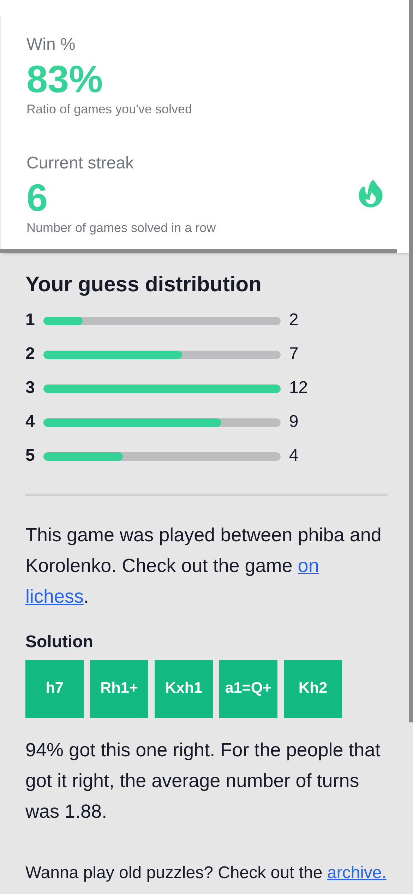
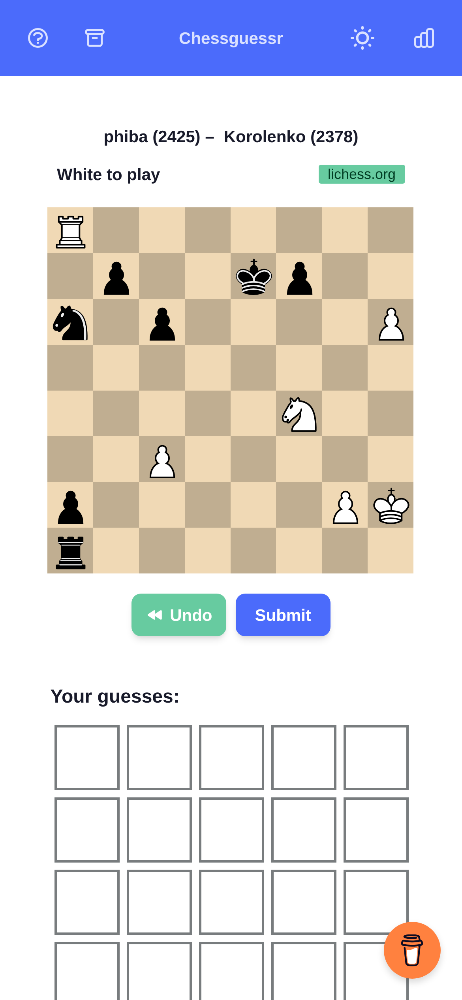
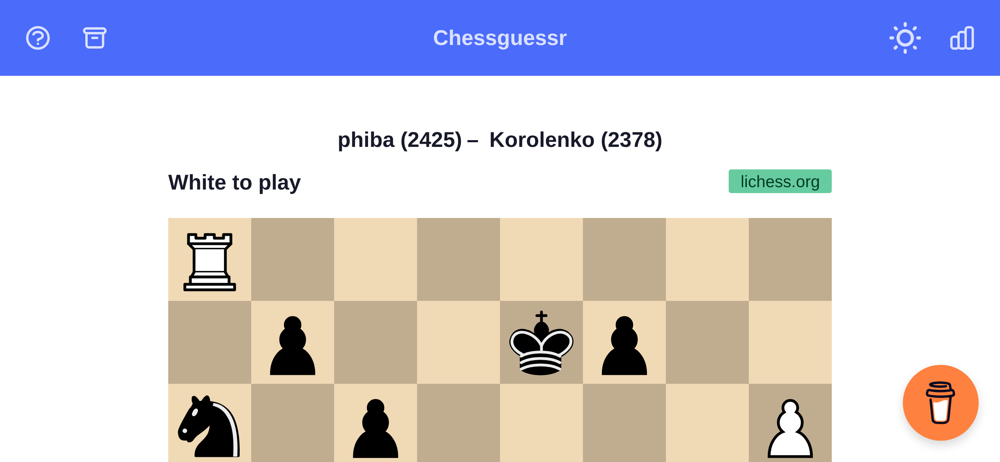
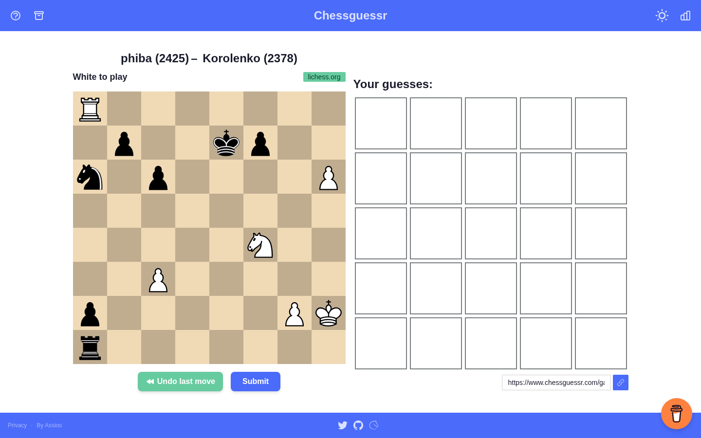
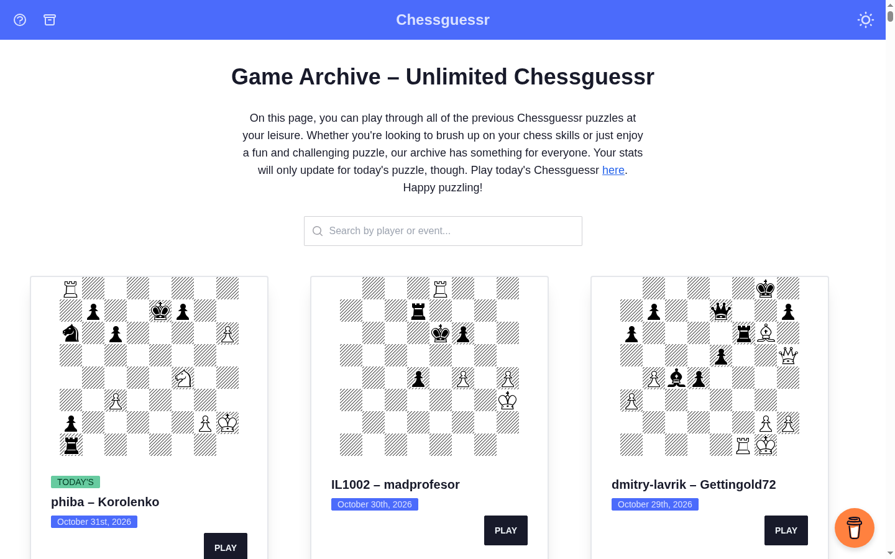

# Chessguessr audit — October 2026

Two independent passes, then a reconciliation round: Opus 5.5 (code, production
requests, headless-browser screenshots at 9 viewports, Mobbin references) and
Fable 5.1 (code, production requests, dependency and branch review). Everything
marked **verified** was reproduced against `master` or production on 2026-10-31.
Screenshots are in [`audit-2026-10/`](audit-2026-10/), and layout measurements in
[`audit-2026-10/metrics.json`](audit-2026-10/metrics.json).

---

## 1. The short version

The game itself is good, and the core loop (board, five tiles, flip animation,
emoji share) works. The problems are around it:

1. **Sharing is broken.** Every per-puzzle `og:image` points at `/api/og`, which
   returns 404 in production, so shared links show no card. The share button
   is also unusable on phones (see 2).
2. **The end-of-game screen is broken on phones.** The modal's top 175–275 px is
   clipped and can't be reached, and **Share** sits below the fold.
3. **The phone layout wastes the screen.** The board is 309 px on a 390 px phone,
   and the guess feedback is below the fold. Landscape phones can't fit the board
   or scroll past it.
4. **Integrity.** `?dates=all` serves tomorrow's puzzle and solution, the public
   repo contains every future solution, and puzzle stats are written straight
   from the browser to Firestore.
5. **The stack is end-of-life.** Remix 1.16, React 17 and daisyUI 2 can't be
   patched without a major upgrade. `npm audit` reports 80 advisories (12 critical).
6. **There's no history.** Only lifetime counters exist in `localStorage`, so
   there are no per-day results, no archive progress, nothing for a streak
   calendar, and nothing real to import into an account later.

None of this needs accounts to fix, and most of it is cheap. Accounts become
much more valuable once there is per-puzzle history to sync.

---

## 2. Findings, ranked

### High

| # | Finding | Evidence | Fix |
|---|---|---|---|
| H1 | **Share cards 404.** `og:image`/`twitter:image` for `/` and `/games/:id` point at `/api/og?...`, which returns Remix's 404 page. `api/og.ts` isn't deployed or routed: the Remix Vercel target owns every path. | verified (prod) · `app/routes/index.tsx:20`, `app/utils/ogImage.ts` | Now: point `og:image` back at the static `/og-image.png` (200 in prod; the root meta already sets it and the route overrides it). Later: make OG a Remix/React Router **resource route** that takes only a puzzle id (today it renders arbitrary `w`/`b` text, cached immutably for a year). |
| H2 | **Result modal clipped on phones.** A `fixed inset-0 flex items-center overflow-y-auto` wrapper with a taller child puts the card top at **-175 px** (iPhone 15) and **-275 px** (iPhone SE/8). The title, the × and "Games played" can't be reached. The page behind it still scrolls, and **SHARE SCORE is at y=917**, below the fold. The tutorial modal uses the same pattern. | verified (browser) · `Modal/Modal.tsx:184`, `TutorialModal.tsx:22` ·  | Quick: `items-start` plus `my-8` (or `m-auto` on the card). Proper: native `<dialog>` as a bottom sheet on phones, with Share as the first action (see §3). |
| H3 | **Phone/tablet layout.** The board width is a JS ladder (560/370/310 px) chosen by `useWindowSize`. The server always renders 560, then it snaps (layout shift). At 390×844 the board is 309 px and the grid spans y=577–914, so feedback is below the fold. In landscape (844×390) the board is 560 px tall in a 390 px viewport, and `touch-action: none` on the wrapper blocks scrolling. On iPad landscape the board and grid stack (page height 1586). The Buy Me a Coffee float covers the 5th tile column on phones. Undo/Submit are 36 px tall, and copy-link is 32 px. | verified (browser) · `Chessguessr.tsx:79`, `ChessgroundBoard.tsx:194-195`, `root.tsx:307` ·   | CSS-sized board, sticky action bar, landscape two-column layout. Spec in §3. |
| H4 | **Future puzzles are public.** `/games/1594?dates=all` (and its `_data` JSON) returns tomorrow's puzzle with the solution. The public GitHub repo has every queued solution in `app/models/game.server.ts`, so removing the flag alone doesn't close it. | verified (prod + raw.githubusercontent.com) · `games/$slug.tsx:90` | Remove `dates=all` now. Structural fix: unpublished puzzles live only in the DB (§4). |
| H5 | **Puzzle stats are writable from the browser.** `incrementSolved`/`incrementFailed` call Firestore `setDoc(..., increment())` from the client. The last committed rules (`auth` branch) allow any write without a `firstSolver` key, including arbitrary values. The deployed rules aren't in the repo. The collection is publicly readable. | verified (client writes, public read) · deployed rules **unverified** · `app/firebase/utils.ts:5` | Move the increment behind a server endpoint with rate limiting. **Export the `stats` collection now**: four years of per-puzzle solve rates, and the export is trivial while it's still readable. |
| H6 | **Home page uncached and coupled to Firestore.** `/` does a Firestore read via the client SDK in the loader on every request (`cache-control: max-age=0`, `x-vercel-cache: MISS`). A Firestore outage or quota hit takes down the whole game, and the stats are only shown after the game ends. | verified (prod headers) · `routes/index.tsx:45` | Cache the page at the edge until midnight UTC (as `/api/daily` already does). Fetch stats lazily after game over from a small endpoint. |
| H7 | **Tutorial flash and hydration mismatch.** `useLocalStorage` reads storage in the `useState` initializer, so the server always renders the tutorial modal and an empty grid. Every returning visitor sees "How to play" flash, and an in-progress game renders empty until hydration. React 17 logs mismatches. | verified (prod HTML contains "How to play") · `root.tsx:199`, `hooks/useLocalStorage.ts` | Read storage after mount (`mounted` gate), or move "tutorial seen" and theme into a cookie read in the root loader. |
| H8 | **Accessibility.** Modals have no `role="dialog"`/`aria-modal`, no focus trap and no Escape. Feedback is colour-only, and the yellow-blue split is hard to tell apart with colour-vision deficiency. White tile text fails contrast: on yellow `#FBBF23` it's 1.7:1, on green `#12B980` 2.5:1, on grey `#9CA3AF` 2.5:1. Moves can't be entered from the keyboard. Global hotkeys `preventDefault` Backspace, Space, Enter and the arrow keys. | verified · `Tile.tsx`, `styles/tile-animations.css`, `Chessguessr.tsx:92` | Native `<dialog>`; a non-colour cue on tiles (corner glyph or ✓-style badge) and a text label per tile; dark text on yellow; an opt-in high-contrast mode rather than a darker default palette (see §3); an optional SAN text input; scope hotkeys to the board area. |

### Medium

| # | Finding | Evidence | Fix |
|---|---|---|---|
| M1 | **Archive is heavy and has no memory.** 1,593 cards rendered at once: 1.25 MB HTML (233 KB gz), 439 KB loader JSON, and every solution included. The page is 398,000 px tall on a phone. Thumbnails come from `images.weserv.nl`→`fen-to-image.com` with no dimensions, and they look nothing like the in-game board. Archive play isn't saved (refreshing loses it), and nothing shows which puzzles you've played. | verified | Strip `solution` from the list loader; group/paginate by month; fixed-size thumbnails from your own renderer; played/solved state from `cg-history` (§4). |
| M2 | **No per-puzzle history.** Only lifetime counters (`cg-stats`) exist. There's nothing for a streak calendar, archive checkmarks, or a real account import. | verified | Ship `cg-history` now (§4). |
| M3 | **Analytics undercount.** `trackPageview()` runs once on mount, so client-side navigations (archive, `/games/:id`) are invisible. `Plausible()` is recreated on every render. A Firestore doc showed ~345 completions against ~700 daily uniques, a funnel worth measuring before building features. | verified · `root.tsx:207,225` | `enableAutoPageviews()` or track on location change; instantiate once. |
| M4 | **Share text breaks on Windows.** Yellow+blue is encoded as 🇺🇦 (two regional-indicator characters). Windows has no flag emoji and shows the letters "UA", misaligning the grid. | verified · `Modal/Modal.tsx:152` | Use single code points, e.g. 🟨 for in-line, 🟦 for right piece, and accept losing the combined state in the share text. Alternatively use a dedicated symbol. |
| M5 | **Firebase SDK on every page.** About 82 KB gz of the ~180 KB gz home-page JS, just to call `increment()`. | verified (bundle sizes) | Firestore REST in the quick-fix phase; gone once stats move to Postgres. |
| M6 | **Dependencies and EOL stack.** `npm audit`: 80 advisories (12 critical, 39 high), many in Remix 1.x itself. `@remix-run/vercel` has no fixed version. React 17 is EOL. `engines: ">=14"` and the Vercel Node runtime are unpinned. Most advisories hit code paths this app doesn't use, so today's real risk is low, but nothing can be patched without the upgrade. | verified | Platform upgrade (§5). |
| M7 | **No CI; broken deploy workflow.** Lint, types and tests don't run on push. ESLint has 21 errors, including rules-of-hooks in `routes/games/index.tsx` (component named `index`). `deploy-to-vercel.yml` references a step id that doesn't exist and uses Node 16. There's no test for `formatGuess`, the one function that must never regress. | verified | GitHub Action: `tsc`, `eslint`, `check-duplicates`, unit tests for scoring. |
| M8 | **No security headers.** No CSP, `X-Content-Type-Options`, `Referrer-Policy` or `frame-ancestors`. The BMC widget loads from a third-party CDN without SRI on every page. | verified (prod headers) | Add headers once the third-party list is final (Plausible proxy, BMC, jsDelivr). |
| M9 | **Countdown does nothing at zero.** A tab left open shows yesterday's puzzle at 00:00:00. | verified · `Chessguessr.tsx:146` | `onComplete` → revalidate or reload. |

### Low

- **Dead code:** `components/UserStatistics/` (duplicates `Modal/`), `components/Achievement/`, `models/achievements.ts`, `components/Navbar/Swap.tsx`, `wrongSolution()` (always false), unreachable code in `convertToIcon()`, `app/.DS_Store`, and the `theme-change` npm package (the CDN copy is the one used). `auth/lichessAuth.ts` imports a package that isn't installed, and its `logout()` calls `localStorage.clear()`, which would wipe players' stats if it were ever wired up.
- **Duplicate URLs:** `parseInt` accepts `/games/01`, `/games/1abc` and `/games/1e3` (`games/$slug.tsx:78`). Validate strictly and redirect.
- **The privacy policy is inaccurate:** it mentions cookies for preferences, but it's localStorage, plus BMC, Plausible and Firebase. It has to be rewritten before accounts exist; the owner is in the EEA, so GDPR applies.
- **The `useLocalStorage` setter** uses a stale closure for functional updates.
- **Local clone only:** `git fsck` reports 3 missing tree objects from January 2026 commits. HEAD is fine. Fix with `git fetch --refetch` or a fresh clone.

---

## 3. Design and UX

### What the screenshots show

| | |
|---|---|
|  | **Phone (390×844).** Small board, big empty margins, feedback below the fold, BMC over the tiles. The brand reads as stock daisyUI "corporate": a generic blue bar, a low-contrast title, a green Undo next to a blue Submit, and a green "lichess.org" badge. |
|  | **Result on phone.** Clipped header. It leads with lifetime stats in a tall vertical stack, and the one action that grows the game (Share) comes last, off-screen. |
|  | **Desktop.** Fine. The empty tiles are 107 px squares, which is a lot of chrome for five short SAN strings. |
|  | **Archive.** Hatched newspaper-style diagrams unlike the game board, a paragraph of SEO copy above the fold, and no sense of progress. |

### Patterns from real apps (Mobbin, iOS)

Mobbin has no Chess.com or Lichess screens, so these come from other daily-puzzle
and habit apps. They're there for structure.

- **The result screen leads with the outcome and the share.** LinkedIn's Wend
  ([screen](https://mobbin.com/screens/a083ebd1-ecfa-4798-a454-cc5164e9b493))
  shows "See you tomorrow!", your time, a comparison ("41% of new players
  couldn't solve this"), a prominent **Send** button, and a locked-leaderboard
  teaser to bring you back tomorrow. Deezer's results
  ([screen](https://mobbin.com/screens/03f4524c-58f4-43e8-8863-58b2cd9e6a97))
  pair your rank among players with **Challenge a friend** as the primary
  button. Chessguessr already has the data for a comparison line ("94% solved
  this · avg 1.9 tries"); today it's buried at the bottom of the modal.
- **Teach in a card, not an essay.** Reddit's daily puzzle games
  ([screen](https://mobbin.com/screens/b41ff8d5-6b31-4eaf-9236-3f01df51c8eb))
  overlay a compact "How to play" card with three bullets and a **Got it!**
  button, with the game visible behind it. Wordle's entry screen
  ([screen](https://mobbin.com/screens/5965f6f3-fda9-4d19-9f6a-90e42735a24e))
  is a one-line rule, a **Play** button, the date and the puzzle number.
- **Show progress as a calendar.** Duolingo's streak screen
  ([screen](https://mobbin.com/screens/801382ea-9bcc-4fd6-b461-a14b36161486))
  and LinkedIn's games hub with per-day **Solve** chips
  ([screen](https://mobbin.com/screens/a2bc6c7e-3472-4f24-b14e-89d1907cdccb))
  are the model for an archive that shows solved, failed and unplayed days.
  This needs `cg-history`.
- **Ask for an account after delivering value.** Brilliant's sign-up
  ([flow](https://mobbin.com/flows/c77bcaf6-3a1c-4253-80e4-23b1b8cf311b))
  comes after the first exercise: "Create a free profile…", then Google, Apple
  or email. For Chessguessr the moment is right after a solve: "Keep your
  6-day streak on every device."

### Proposed layout

**Phone, portrait (< 640 px)**
- Board: `width: min(100vw - 24px, 100dvh - <chrome>)`, i.e. 366 px on a 390 px
  phone.
- One-line header under the navbar: players and ratings, "White to play" and the
  source.
- The current guess row sits directly under the board so you see your moves land.
  Then a **sticky action bar** (`position: sticky; bottom: 0`, 56 px): Undo |
  **Submit**, each ≥ 44 px tall. Submit stays disabled with a "3/5 moves" label
  instead of an error toast.
- Guess rows use **rectangular tiles (~68 × 44 px)** rather than squares. Five
  rows take ~240 px, so on a 390×844 phone the navbar, header, board, action bar
  and all five rows (~760 px) fit with no scrolling. (Fable's alternative keeps
  ~68 px squares and `scrollIntoView`s the scored row. Prototype both; the
  rectangular version avoids scrolling entirely on phones ≥ 800 px tall.)
- No BMC float below 640 px; move it into the footer or a menu.

**Phone, landscape (height ≤ 500 px):** two columns (`grid-template-columns: auto
1fr`). The board is `calc(100dvh - 72px)` on the left; the grid and action bar are
on the right. Apply `touch-action: none` to `cg-board` only, not the wrapper, so
the margins scroll.

**Desktop (≥ 900 px, which includes iPad landscape):** side by side as today, with
the board at `min(560px, 100dvh - 200px)` so 768-px-tall laptops don't scroll,
~56 px tiles, and the action bar under the board.

**Result sheet:** a native `<dialog>`, bottom sheet on phones and centred on
desktop. Order:
1. Outcome headline ("Solved in 3/5" / "Not this time").
2. Your rows plus the solution row.
3. **Share** as a full-width primary button.
4. Community line (% solved, average tries).
5. Streak and "Next puzzle in 08:30:02".
6. Lifetime stats and distribution, compact or collapsed.
7. "Play the archive".

Show the game players/event and the "see the game on Lichess" link after a
solve or a fail.

**Visual system:** a custom theme instead of `corporate`. One primary button
style, sentence case (no `SHARE SCORE` or red `CLOSE`), quiet header and footer
chrome. The board colours (Lichess brown) and the bright tile colours are
the game's identity. **Keep the tile palette.** A darker, AA-compliant palette
was tried in Phase 0 and rejected: it looked muddy. Other tile games keep
vivid feedback colours and get readability from dark text on bright fills
([Duolingo](https://mobbin.com/screens/bfdbb9c2-d906-4849-bbd2-4d48cecaa70a))
or non-colour cues ([LinkedIn Wend's ✓ badges](https://mobbin.com/screens/9de19855-9f1a-4a72-ae91-2a916eeda115)).
So: dark text on the yellow tile (done), and an opt-in high-contrast or
colour-blind mode. The rest of the chrome should complement the board rather
than fight it.

---

## 4. Data: puzzles, stats, history

**Puzzles (agreed with Fable after round 2):**
- **Unpublished puzzles live only in the database.** Add them through a small admin
  page or CLI: paste a Lichess URL, the server fetches the PGN, you pick the ply,
  it validates the five SAN moves with chess.js, checks duplicates and schedules
  the puzzle. This replaces hand-editing a 557 KB TypeScript file. The current
  `checkDuplicates.ts` rules become DB constraints plus a validation function.
- **Published puzzles are exported back to the repo** as JSON per year by a
  nightly job, so the open dataset and the archive stay reproducible and the
  repo stays public without spoilers. We rejected a private repo (it throws away
  the open-source story for a secret nobody's attacking) and an encrypted file in
  git (theatre, and it makes PRs unreviewable).
- Store: Postgres (e.g. Neon) with Drizzle. Seed it from the current file. `id`
  becomes a real primary key instead of an array index.

**Stats:** derived from real rows (`results`), not free-for-all counters.
Anonymous completions go through a rate-limited server endpoint. Export the
Firestore `stats` collection before turning Firebase off.

**`cg-history`: ship it now, before any backend.** A versioned localStorage map
keyed by the **puzzle's date string from loader data** (never `new Date()`):

```json
{ "v": 1,
  "2026-10-31": { "s": "W", "t": 3, "g": ["ggyxg", "gg?xg", "ggggg"], "a": 0 } }
```

- Fields: `s` W/L, `t` turns, `g` one string per row with one character per tile
  (`g`/`y`/`b`/`x`, and `d` for yellow+blue), `a` 1 for archive play.
- Write it once at game end, never per guess.
- Never derive `cg-stats` from it; the old aggregates predate history, so the two
  coexist.
- Archive results go into history but not into stats or streaks.
- Backfill today's finished `cg-state` so existing players get their first row.

This makes archive checkmarks and a streak calendar possible with no backend, and
gives the eventual account import real per-puzzle rows.

---

## 5. Platform recommendation

- **Framework:** React Router 7 (framework mode) + React 19 + Vite. It's the only
  supported path from Remix 1. Port on top of `master`. Use the
  `react-router-v7-convex` branch only as a crib sheet (its `routes.ts`, configs
  and loader rewrites), not as a base: it's seven months behind, drops
  `api/og.ts`, keeps `dates=all`, and its Convex functions expose every puzzle
  and allow unauthenticated writes.
- **Styling:** **keep daisyUI, but on v5 with Tailwind 4 and a custom theme.** The
  problem isn't daisyUI; it's daisyUI 2 plus the stock theme plus hand-rolled
  modals. The app has about six real UI components, and daisyUI 5's `modal` is
  built on native `<dialog>`, which fixes focus and Escape for free. Use
  `modal-bottom sm:modal-middle` for the result sheet. Not shadcn/ui wholesale:
  it means owning dozens of copied components for a game with six. Reconsider if
  (a) you end up overriding most daisyUI classes for a custom look, or (b) the
  result sheet needs swipe-to-dismiss. In that case add Vaul for that one sheet.
- **Hosting:** stay on Vercel. Edge-cache puzzle pages until midnight UTC. OG
  becomes a resource route.

---

## 6. Accounts (for when you pick a provider)

The provider decision is deferred. Notes for when you get there:

- **Shortlist (both reviewers):**
  1. **Better Auth** (self-hosted library on your Postgres, no per-user pricing;
     Lichess via generic OAuth with PKCE and no client secret, plus Google and an
     email magic link; an anonymous plugin that links on sign-in). Both reviewers
     lean this way.
  2. **Lichess-only OAuth**, hand-rolled with Arctic and a signed cookie.
     Smallest, strongest audience fit, excludes non-Lichess players.
  3. **Clerk:** fastest and most polished. Hosted dependency; whether it supports
     a custom Lichess provider on the free plan is unverified.
- **Anonymous play stays first-class.** Prompt for an account after a solve
  ("keep your streak across devices"), never at entry.
- **Import:** `cg-history` rows become real `results` rows. `cg-stats` becomes a
  one-time baseline, applied only if the account has no results yet. Upsert on
  (user, puzzle) so it's idempotent. Never clear localStorage.
- **Integrity split:**
  - Fable's position: anonymous play stays client-evaluated. Signed-in play posts
    its guesses once at game end, and the server re-evaluates and stores its own
    verdict. Anything competitive reads only server rows.
  - My caveat: that stops forged results but not reading today's solution from
    the page source. It's fine for friends and streaks. Global leaderboards would
    need per-submit server evaluation with the solution withheld until game end.
    Decide when leaderboards are on the table.
- Rewrite the privacy policy and add account deletion and export (GDPR) before
  launch.
- Decide on **midnight UTC vs local midnight** before accounts. Streak logic
  depends on it, and for the Americas the puzzle currently flips mid-evening.

---

## 7. Plan

**Phase 0: quick fixes on the current stack (days)**
1. Result modal: fix clipping; Share first and above the fold (H2).
2. Share cards: static `og-image.png` now (H1).
3. Phone layout: CSS board sizing, sticky action bar, landscape layout, BMC off
   on phones, 44 px targets (H3).
4. `cg-history` plus single-codepoint share emoji (M2, M4).
5. Remove `?dates=all` (H4). Export Firestore `stats`, then move increments
   server-side or to REST (H5, M5).
6. Plausible route tracking (M3); fix the deploy workflow; CI with `tsc`,
   `eslint`, `check-duplicates` and `formatGuess` tests (M7).
7. Tutorial flash (H7), countdown `onComplete` (M9), dead-code removal, and
   dark text on the yellow tile.

**Status (2026-10-31):** items 1–4, 6 (except the deploy workflow) and 7 are
done on branch `phase-0-fixes`
([after](audit-2026-10/after/phone-game-and-result.png)). Item 5 is deferred:
spoiler and anti-cheat fixes rank below UX work for now.

**Phase 1: platform and design system.** React Router 7 / React 19 / Vite /
Tailwind 4 / daisyUI 5 with a custom theme. Native `<dialog>` for result and
tutorial. Edge caching. OG resource route (id only). Security headers. The
redesigned game, result, onboarding and archive screens from §3.

**Phase 2: data.** Postgres plus Drizzle; puzzles table with admin/CLI and
nightly export; `results` and derived stats; Firebase removed; archive driven
by month and history.

**Phase 3: accounts.** Provider per §6; anonymous-first; import; profile with
streak calendar.

**Phase 4: retention.** Leaderboards, challenge-a-friend, streak freeze, a
"what happened next" replay, and reminders. Pick using the Phase 0 analytics.

---

## 8. Where we'd push back on the brief

- **Login alone won't move retention.** Accounts pay off when there's something
  to sync (history, streak calendar, archive progress). Broken share cards and
  an unusable result screen on phones are bigger growth levers right now, and
  cheaper.
- **The "huge file" isn't really a size problem.** It's a secrecy problem (public
  future solutions), an authoring problem (hand-editing TS), and a
  relational-data problem (results need puzzle rows). That's why it moves to a
  DB, not just to a JSON file.
- **Measure before building features.** Archive traffic is invisible today, and
  completions look like roughly half of daily uniques. Fix tracking in Phase 0
  and let the numbers pick the Phase 4 features.

## 9. Housekeeping

- **Old branches:** `auth`, `server-side-fb`, `blog`, `custom`, `custom-games`,
  `guess-the-game`, `i18n`, `quiz`, `chessground-and-promotion`,
  `type-improvements` (its goal is already met on master) and the dependabot
  branch are all safe to delete. Keep `react-router-v7-convex` until the
  migration is done. `GROWTH_IDEAS.md` lives only on
  `claude/website-growth-analysis-lY9lY`; move it to `docs/` if you want to keep it.
- **Firestore:** a `users` collection from the scrapped auth work may exist. Check
  it for real data and delete it along with the project.
